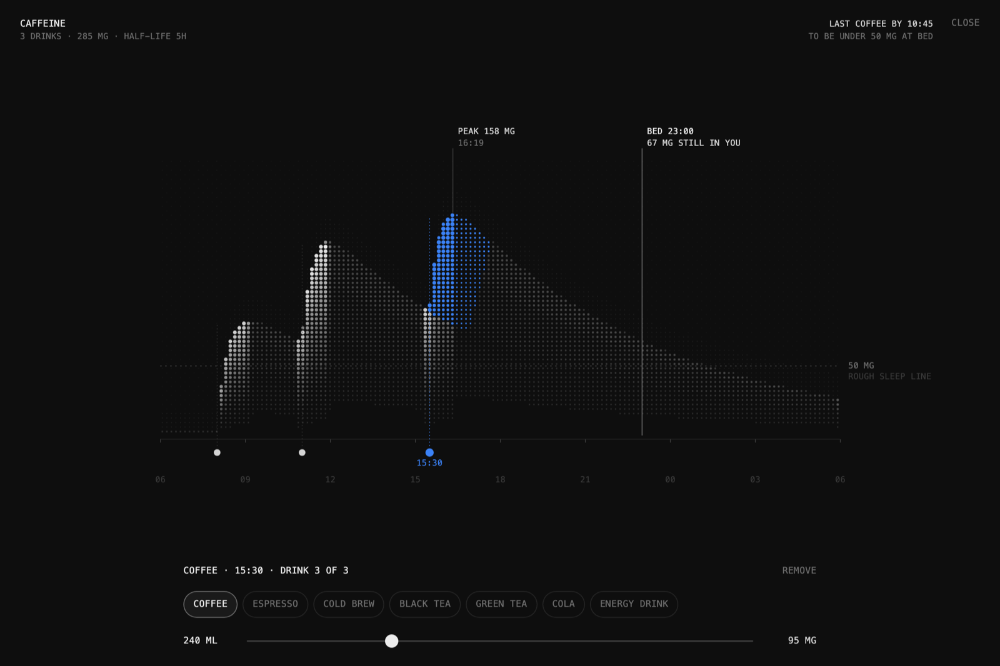

# Caffeine Day

How much caffeine is still in you at bedtime, drawn as a lit ridge of dots.
Drag your drinks along the day and watch the bedtime number move.



**Try it:** [baobun.studio/demo/caffeine](https://baobun.studio/demo/caffeine)

- Drag a drink along the day. Tap empty space to add one.
- Tap a drink to pick what it is (coffee, espresso, cold brew, black tea,
  green tea, cola, energy drink) and how much you had.
- Drag the bed line to change your bedtime.
- The top right tells you the latest time for your last drink if you want to
  be under 50 mg at bed.
- Your day is saved in the URL, so you can share it.

Keyboard: focus the chart, then ← → move the selected drink by 15 minutes
(shift for an hour), `[` `]` pick the previous or next drink, delete removes it.

## Run it

No build, no dependencies. Serve the folder with any static server:

```bash
npx serve .
```

or `python3 -m http.server`, then open the address it prints. (Opening
`index.html` straight from disk won't work, because browsers block ES modules
on `file://`.)

To put it in your own page:

```html
<div id="caffeine" style="height: 100vh"></div>
<script type="module">
  import { mount } from './caffeine.js';
  mount(document.getElementById('caffeine'));
</script>
```

`mount(el, { widget: true })` shows it as a small card that opens full screen
(what `index.html` does). `mount(el, { hash: false })` turns off the URL state.

## The model

A one-compartment model with first-order absorption, summed over every drink:

```
C(t) = Σ dose · kₐ / (kₐ − kₑ) · (e^(−kₑ·d) − e^(−kₐ·d))
```

where `d` is the hours since that drink, `kₐ = ln 2 / 0.25 h` (absorbed with a
15-minute half-life, so it peaks about an hour after drinking) and
`kₑ = ln 2 / 5 h` (a 5-hour elimination half-life).

Caffeine per drink, from typical Mayo Clinic and USDA figures:

| Drink | Reference serving | Caffeine |
| --- | --- | --- |
| Coffee (brewed) | 240 ml | 95 mg |
| Espresso | 30 ml | 63 mg |
| Cold brew | 473 ml | 205 mg |
| Black tea | 240 ml | 47 mg |
| Green tea | 240 ml | 28 mg |
| Cola | 355 ml | 34 mg |
| Energy drink | 250 ml | 80 mg |

Other volumes scale linearly. The 50 mg "sleep line" is a rough rule of
thumb, not a medical threshold.

## Not medical advice

Real drinks vary a lot (a coffee can be 60 mg or 200 mg), and so do people:
the half-life runs from about 3 to 7 hours in healthy adults and is longer
during pregnancy, with some medications, and shorter in smokers. Use it to get
a feel for the shape of your day, not to make health decisions.

## Licence

MIT. Made by [Charles Postiaux](https://x.com/PostiauxCharles) at
[Baobun Studio](https://baobun.studio).
